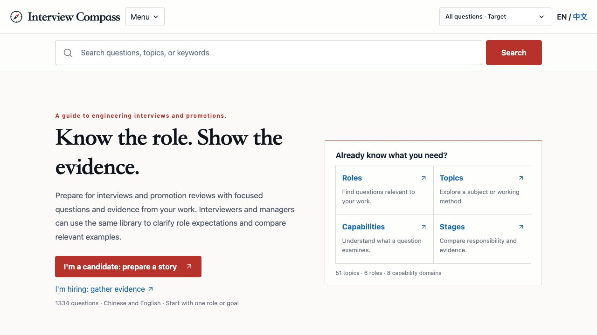
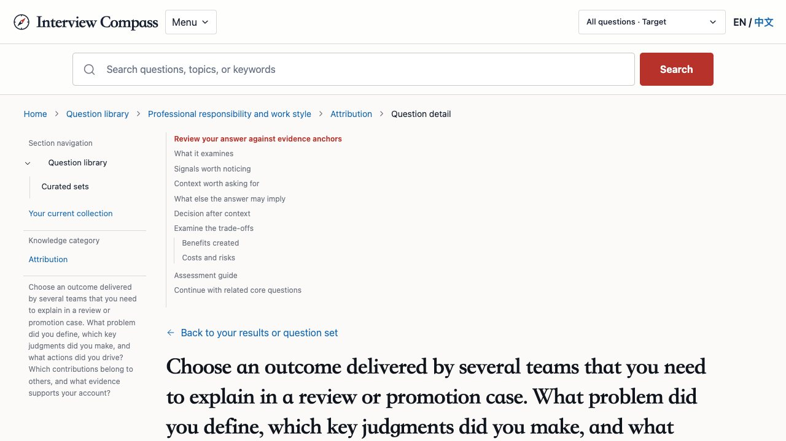
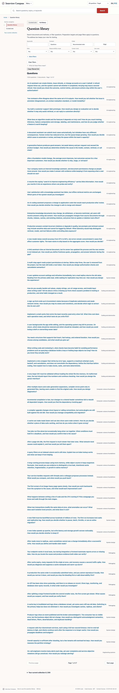

# Interview Compass

**A guide to engineering interviews and promotions.**

**Know the role. Show the evidence.**

A practical reference for candidates, interviewers, and engineering managers. Understand what a role needs and what a question is testing, then use contextual, verifiable experience to explain capability and fit.

**[Open the English site](https://liyuk.github.io/interview-compass/)** · **[Chinese site](https://liyuk.github.io/interview-compass/zh/)** · **[README in Chinese](README.zh-CN.md)**

[](https://github.com/Liyuk/interview-compass/actions/workflows/deploy.yml)
[](LICENSE)
[](CONTENT-LICENSE.md)

## Built from practice

The method draws on a decade of work and screening criteria from leading internet companies. In the past five years, I have interviewed about 1,000 candidates and coached about 300 people. More than 200 managers have attended my training. The method has supported promotions from junior roles to second-line management; an earlier version received roughly 20,000–30,000 reads.

[Read the thinking behind the site](https://liyuk.github.io/interview-compass/approach/) · [Star the repository](https://github.com/Liyuk/interview-compass)

## What's inside

- **Goal paths.** Six paths for external interviews, campus hiring, interviewer design, promotion, self-reflection, and operations review. Five cross-domain paths cover product thinking, questioning, and business, technical, and team planning.
- **Curated question sets.** Ordered sets for general interviews, technical fundamentals, interviewer evidence, and promotion conversations, plus a due-diligence guide for questions to ask an employer.
- **Capability map.** Eight domains, A–H: professional problem solving, business understanding, judgment, delivery, collaboration, organization, learning, and professional responsibility. Each question has one primary capability.
- **Search and filters.** Search in Chinese and English. Filter the library by role, scenario, scope, track, capability, topic, and format. Choose an engineering specialization and responsibility stage to see relevant questions and results.
- **AI analysis prompts.** Build a structured prompt from a question page for an external AI tool you choose. The prompt stays on the page until you copy it.
- **Companion skill.** [`skills/interview-compass-coach/`](skills/interview-compass-coach/) uses the public question feed for practice and review, with the same evidence and privacy limits.

## Screenshots

[](https://liyuk.github.io/interview-compass/)

[](https://liyuk.github.io/interview-compass/questions/h-attribution-team-vs-personal/)

[](https://liyuk.github.io/interview-compass/questions/)

## About

Interview Compass is a bilingual reference for external interviews, hiring, promotion, and project reflection. Start with a role or goal, then use questions to compare approaches, examine context and causality, and make contributions visible through evidence. It does not prescribe answers or automatically score people.

This repository contains the site and its source content. It serves engineers, interviewers, and engineering managers. Product sense, operating workflows, design collaboration, and commercial reasoning help engineers understand the business around their work; they are not separate target careers.

Maintainer reference: [current site architecture](docs/architecture/current-state.md). Dated plans, reviews, and design explorations record past decisions rather than the current implementation.

If the site helps with preparation, interviewing, or hiring, please [star the repository](https://github.com/Liyuk/interview-compass) or [suggest a question](https://github.com/Liyuk/interview-compass/issues/new).

## Explore locally

Requirements: Node.js 24 and npm.

```sh
npm ci
npm run dev
```

English pages use the site root; Chinese pages use `/zh/`. The site includes six goal-based paths, curated question sets, a filterable question library, guides, an eight-domain capability map, role, scenario and topic views, and question pages. Question cards distinguish reviewed analysis from shared reading prompts. Stage profiles describe role-specific behaviors and evidence for professional contributors and managers. Visitors can choose an engineering specialization and responsibility stage, then browse matching questions and search results. Shared links preserve each recipient's saved preference. Search uses Pagefind by language and reviewed role–stage combination. The GitHub Pages base path is `/interview-compass/`.

Each question page can generate an analysis prompt for an external AI tool selected by the visitor. The site does not collect answers or send them anywhere. The question library also provides a compact public data feed used by the companion skill.

## Checks

```sh
npm run check
npm run check:content
npm run check:stage-coverage
npm run test:unit
npm run build
npm run test:e2e
```

Run the full CI sequence with `npm run ci`. The browser suite previews the built site under the repository base path on port 5027.

## Content model

Question records live under `src/content/questions/zh-CN/` and `src/content/questions/en/`. Keep each pair aligned by stable question ID and identical primary capability. Frontmatter provides the question, intent, observable signals, one primary capability leaf, independent facets, and provenance. Shared 1–4 evidence references are not stored as question-specific judgments. Individually reviewed analysis, alternative interpretations, context probes, comparison dimensions, trade-offs, and four anchors live in `src/data/question-specific-analyses.json`, paired by ID and locale and validated against the published library. Curated sets reference IDs in `src/lib/question-collections.ts`; candidate due-diligence prompts use a separate, non-scored format. The vocabulary lives in `src/lib/taxonomy.ts`; routes, titles, and breadcrumbs come from `src/lib/routes.ts`. Source review status is tracked in `docs/planning/source-ledger/*.yml` and validated by `npm run check:content`.

Public preparation offers six engineering directions and 36 role–stage combinations. Cross-functional role models remain source research without separate public target routes. Twenty-eight cases that previously focused on other functions include an engineering reading context, also included in their optional AI prompt and public feed. All 1,334 questions are retained.

Role-specific models are in `src/content/role-stages/`. Each bilingual question ID has reviewed role–stage combinations in `src/content/question-applicability.json`. `check:stage-coverage` rejects pending reviews, stale fingerprints, and empty reviewed profiles. One question may serve several stages; the stage changes expected responsibility and evidence, not question difficulty or an automatic score. Stage reading prompts are labeled as rule-based rather than individually reviewed stage-specific analysis.

## Deployment

`.github/workflows/deploy.yml` runs the full CI sequence for pull requests, pushes to `main`, and manual runs. It checks Astro types, content and source records, stage applicability, unit tests, static output and Pagefind indexing, then desktop and mobile Chromium browser tests. It uploads the Pages artifact and deploys only from the default branch (`main`), so pull requests verify the site without publishing it. The live site is [liyuk.github.io/interview-compass](https://liyuk.github.io/interview-compass/), hosted with GitHub Actions.

## Copyright and licensing

Copyright © 2026 Liyuk. Software code is licensed under MIT (`LICENSE`). Original Interview Compass questions and bilingual capability-model stage descriptions are licensed under CC BY-NC-SA 4.0 (`CONTENT-LICENSE.md`). Company mappings, source-derived material, third-party content, and externally attributed work are excluded from that license and remain subject to their respective rights and terms.
