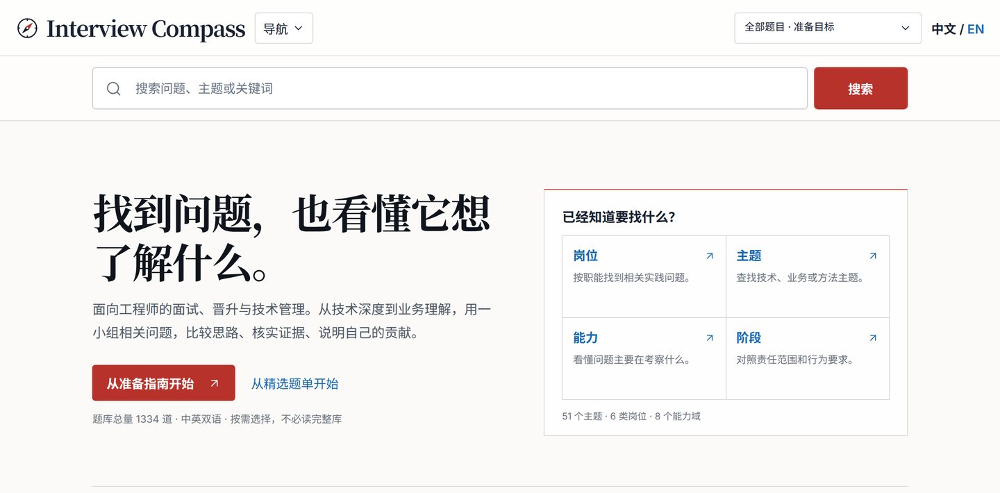
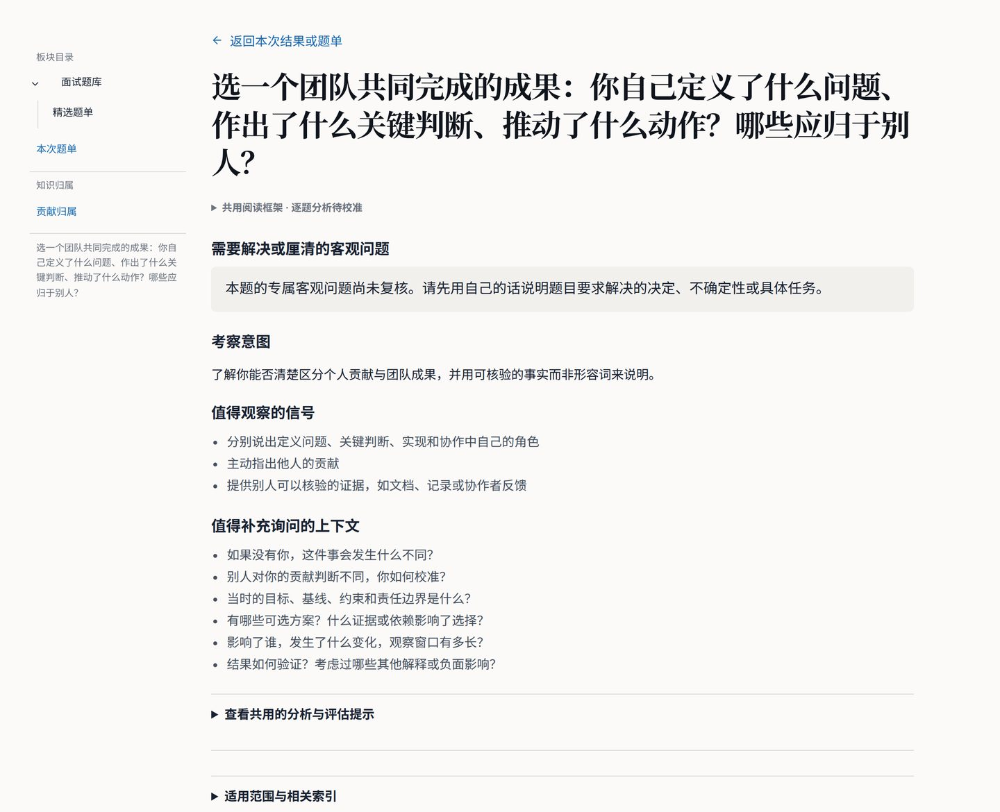
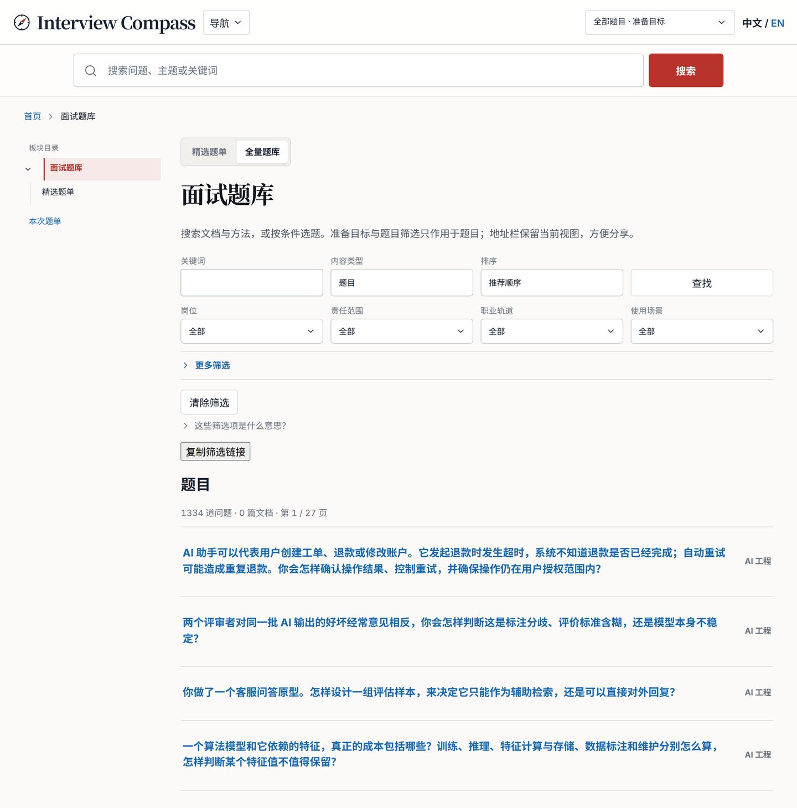

# Interview Compass

[](https://github.com/Liyuk/interview-compass/actions/workflows/deploy.yml)
[](LICENSE)
[](CONTENT-LICENSE.md)

面向工程师与工程经理的双语面试 / 晋升问题库：从目标出发，用好问题而不是标准答案来准备。

A bilingual interview and promotion question library for engineers and engineering managers: start from a goal, and prepare with good questions rather than model answers.

**[打开中文站点](https://liyuk.github.io/interview-compass/)** · **[Open the English site](https://liyuk.github.io/interview-compass/en/)**

## What's inside

- **Goal paths.** Six scenario paths: external interviews, campus hiring, interviewer design, promotion, self-reflection, and operations review. Five cross-domain paths cover product thinking, questioning, and business, technical, and team planning.
- **Curated question sets.** Short ordered sets for a general interview, technical essentials, interviewer evidence, and promotion conversations, plus a due-diligence guide for reverse questions.
- **Capability map.** Eight domains, A–H: professional problem solving, business understanding, judgment, delivery, collaboration, organization, learning, and professional responsibility. Each question has one primary capability.
- **Search and filters.** Pagefind search in Chinese and English. The full library filters by role, scenario, scope, track, capability, topic, and format. Pick one of six engineering specializations and a responsibility stage, and questions plus search stay on reviewed matches.
- **AI analysis prompts.** A question page can build a structured prompt for an external AI tool you choose. The prompt stays on the page until you copy it.
- **Companion skill.** [`skills/interview-compass-coach/`](skills/interview-compass-coach/) looks up the public question feed for practice or review, with the same evidence and privacy limits.

## See it

[](https://liyuk.github.io/interview-compass/)

[](https://liyuk.github.io/interview-compass/questions/h-attribution-team-vs-personal/)

[](https://liyuk.github.io/interview-compass/questions/)

## About

Interview Compass is a bilingual, question-first heuristic library for external interviews, hiring, promotion, and project reflection. Start from a goal or search directly; use questions to compare approaches, examine context and causality, and make contribution visible through evidence. It does not prescribe answers or automatically score people.

This repository contains the Interview Compass site and its source content. The site serves engineers and engineering managers. Product sense, operating workflows, design collaboration, and commercial reasoning expand engineering business understanding; they are not separate target careers.

Maintainer reference: [current site architecture](docs/architecture/current-state.md). Dated plans, reviews, and design explorations record past decisions and should not be read as a description of the current implementation.

## Explore locally

Requirements: Node.js 24 and npm.

```sh
npm ci
npm run dev
```

The site has Chinese and English routes for the home page, six goal-based paths, curated question sets, a filterable full library, a user guide, the questioning framework, an eight-domain capability map, role, scenario and topic views, and question pages. Question cards distinguish individually reviewed analysis from shared reading prompts. Stage profiles describe role-specific behaviors, evidence to inspect, and the distinction between professional-contributor and management paths. First-time visitors can select one of six engineering specializations and a responsibility stage, then browse strictly matching questions and search results. The header always allows changing the target or viewing all questions. A shared link temporarily overrides the local choice without overwriting it. Search uses Pagefind per language and reviewed role–stage combination. The Pages base path is `/interview-compass/`; the Chinese site is at `/interview-compass/` and English at `/interview-compass/en/`.

Each question page can generate a structured analysis prompt for a user-selected external AI tool. The site does not collect answers or send them anywhere. The question library also has a compact public data feed for selected question cards. The companion skill at `skills/interview-compass-coach/` uses that feed for question lookup and follows the same evidence and privacy limits.

## Checks

```sh
npm run check
npm run check:content
npm run check:stage-coverage
npm run test:unit
npm run build
npm run test:e2e
```

Or run the full CI sequence with `npm run ci`. The browser suite previews the built site under the real repository base path on port 5027.

## Copyright and licensing

Copyright © 2026 Liyuk. Software code is licensed under MIT (`LICENSE`). Original Interview Compass questions and the bilingual capability-model stage descriptions are licensed under CC BY-NC-SA 4.0 (`CONTENT-LICENSE.md`). Company mappings, source-derived, third-party, and externally attributed material are excluded from that content license and remain subject to their respective rights and terms.

## Content model

Question records live under `src/content/questions/zh-CN/` and `src/content/questions/en/`. Keep each pair aligned by stable question ID and identical primary capability. Frontmatter provides the question, intent, observable `signals`, exactly one `primaryCapability` leaf, independent facets (topics, roles, scopes, tracks, scenarios, formats) and provenance. Shared 1–4 evidence references are not stored as question-specific judgments. Individually reviewed objective analysis, alternative interpretations, context probes, comparison dimensions, trade-offs and four anchors live in `src/data/question-specific-analyses.json`; that file is paired by ID and locale and validated against the published bank. Curated sets reference question IDs in `src/lib/question-collections.ts`; candidate due-diligence prompts use a separate, non-scored shape. The single vocabulary lives in `src/lib/taxonomy.ts`; routes, titles and breadcrumbs come from `src/lib/routes.ts`. Source review status is tracked in `docs/planning/source-ledger/*.yml` and validated by `npm run check:content`. `npm run report:coverage` prints unique question counts by domain, role, scenario, format and locale. `docs/planning/` contains the MECE architecture, research, and migration plans. Public project snapshots are archived outside this repository and are not part of the site build.

Public preparation offers six engineering directions and 36 role–stage combinations. Cross-functional role models remain source research, without separate public target routes. Twenty-eight previously function-specific cases include an explicit engineering reading context, also included in their optional AI prompt and public feed. All 1,334 questions are retained.

Role-specific models are in `src/content/role-stages/`. Each bilingual question ID has explicit reviewed role–stage combinations in `src/content/question-applicability.json`. `check:stage-coverage` rejects pending reviews, stale fingerprints and empty available targets. The generated report is `docs/reviews/2026-10-16-stage-applicability-coverage.md`. One question may serve several stages; the stage changes expected responsibility and evidence, not question difficulty or an automatic 1–4 score. Stage reading prompts are labeled as rule-based, rather than individually reviewed stage-specific analyses.

## Deployment

`.github/workflows/deploy.yml` runs the full CI sequence on pull requests, pushes to `main`, and manual dispatch: Astro type checks, content and source-ledger validation, complete stage-applicability coverage, unit tests, static build and Pagefind indexing, then desktop and mobile Chromium browser tests. It uploads a Pages artifact and deploys only from the repository's default branch (`main`); pull requests and feature branches verify the site without publishing it. The published site is at [liyuk.github.io/interview-compass](https://liyuk.github.io/interview-compass/), using GitHub Actions.
