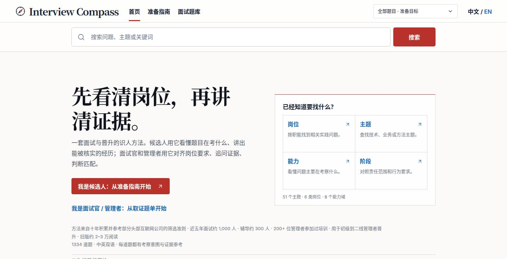
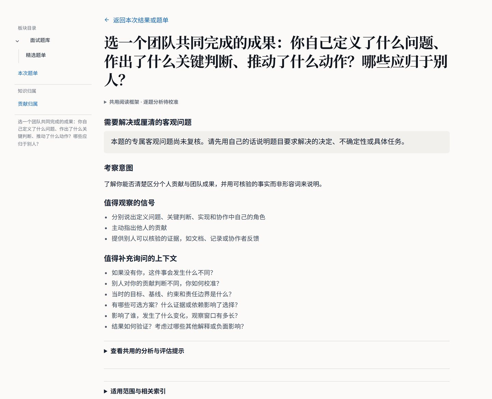
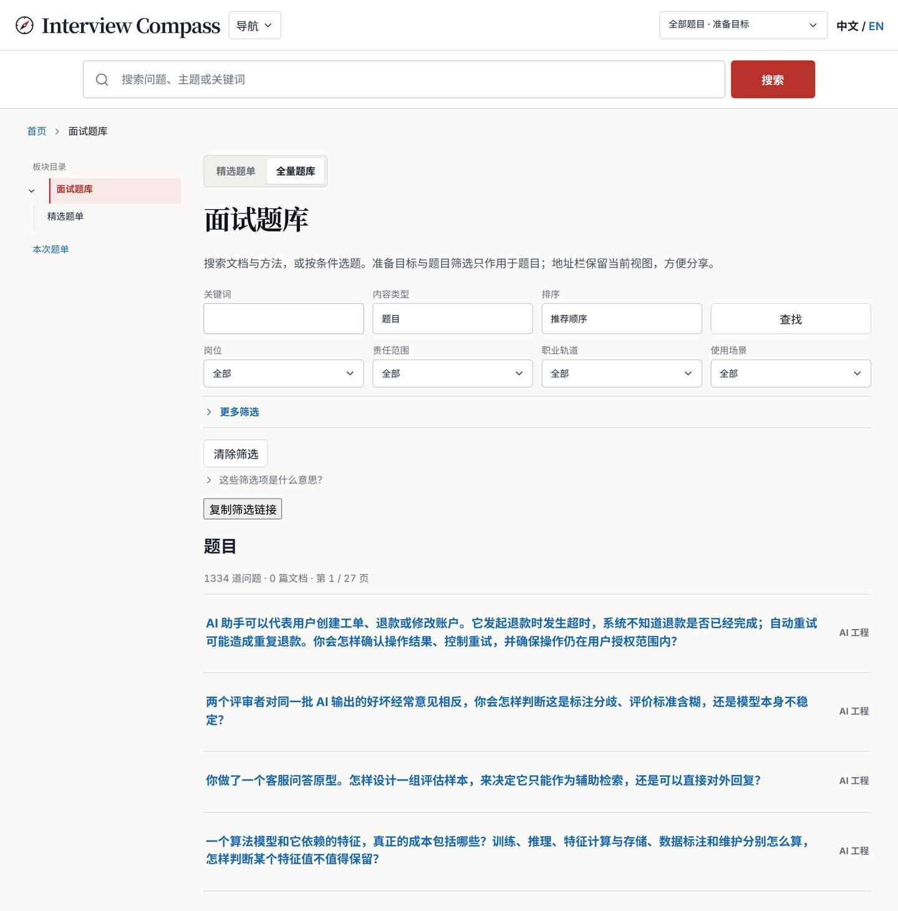

# Interview Compass

**工程师的面试与晋升指南。**

**先看清岗位，再讲清证据。**

面向候选人、面试官和工程管理者的实用参考。先理解岗位需要什么、问题想判断什么，再用有上下文、可核实的经历说明能力与匹配度。

**[打开中文站点](https://liyuk.github.io/interview-compass/zh/)** · **[Open the English site](https://liyuk.github.io/interview-compass/)** · **[English README](README.md)**

[](https://github.com/Liyuk/interview-compass/actions/workflows/deploy.yml)
[](LICENSE)
[](CONTENT-LICENSE.md)

## 来自实践

这套方法积累于十年工作，也参考了部分头部互联网公司的筛选准则。近五年面试约 1,000 位候选人、辅导约 300 人，200 多位管理者参加过培训。方法用于从初级岗位到二线管理者的晋升，旧版曾有约 2 万至 3 万次阅读。

[了解网站背后的思路](https://liyuk.github.io/interview-compass/zh/approach/) · [给仓库点星](https://github.com/Liyuk/interview-compass)

## 项目内容

- **目标路径。** 六类路径覆盖外部面试、校园招聘、面试设计、晋升、自我复盘和运营复盘；另有五条跨领域路径，涉及产品思维、提问，以及业务、技术和团队规划。
- **精选题单。** 提供综合面试、技术基础、面试取证、晋升交流等题单，以及帮助候选人反向了解雇主的尽调指南。
- **能力地图。** 八个领域（A–H）：专业问题解决、业务理解、判断、交付、协作、组织、学习和职业责任。每道题只对应一个主要能力。
- **搜索与筛选。** 中英文搜索。题库可按岗位、场景、责任范围、发展方向、能力、主题和题型筛选。选择工程方向与责任阶段后，可查看匹配的问题和搜索结果。
- **AI 分析提示词。** 可从题目页面生成结构化提示词，复制到自己选择的外部 AI 工具。提示词会留在当前页面，直到你主动复制。
- **配套技能。** [`skills/interview-compass-coach/`](skills/interview-compass-coach/) 使用公开题库数据，支持练习和复盘，并遵循相同的证据与隐私边界。

## 页面截图

[](https://liyuk.github.io/interview-compass/zh/)

[](https://liyuk.github.io/interview-compass/zh/questions/h-attribution-team-vs-personal/)

[](https://liyuk.github.io/interview-compass/zh/questions/)

## 项目介绍

Interview Compass 为面试、招聘、晋升和项目复盘提供双语参考。可以从岗位或目标开始，用问题比较不同做法、检查上下文和因果关系，再通过证据说明个人贡献。网站不提供标准答案，也不会自动给人打分。

本仓库包含网站和源内容，服务于工程师、面试官和工程管理者。产品判断、运营流程、设计协作和商业思维用于帮助工程师理解工作的业务背景，不是独立的目标职业方向。

维护者参考：[当前网站架构](docs/architecture/current-state.md)。带日期的计划、评审和设计探索记录的是过往决策，不代表当前实现。

如果本站对准备面试、开展面试或招聘决策有帮助，欢迎[给仓库点星](https://github.com/Liyuk/interview-compass)或[建议新题目](https://github.com/Liyuk/interview-compass/issues/new)。

## 本地运行

需要 Node.js 24 和 npm。

```sh
npm ci
npm run dev
```

英文页面位于站点根路径，中文页面位于 `/zh/`。网站包括六条目标路径、精选题单、可筛选题库、指南、八领域能力地图，以及岗位、场景、主题和题目页面。题卡会区分经过审核的分析和通用阅读提示。阶段模型说明专业贡献者与管理者在不同岗位阶段应承担的行为和证据。访客可选择工程方向和责任阶段，浏览匹配问题并搜索。分享链接会保留访问者自己的偏好。Pagefind 按语言和经过审核的岗位—阶段组合建立搜索索引。GitHub Pages 项目路径为 `/interview-compass/`。

每道题都可以生成分析提示词，供访客自行选择外部 AI 工具。网站不收集回答，也不会把回答发送到其他地方。题库还提供精简的公开数据源，供配套技能查询。

## 检查

```sh
npm run check
npm run check:content
npm run check:stage-coverage
npm run test:unit
npm run build
npm run test:e2e
```

运行完整 CI 流程：`npm run ci`。浏览器测试会在 5027 端口按仓库实际部署路径预览构建结果。

## 内容模型

题目记录位于 `src/content/questions/zh-CN/` 和 `src/content/questions/en/`。中英文版本使用相同的稳定题目 ID，并保持主要能力一致。Frontmatter 保存题目、意图、可观察信号、唯一主要能力、独立分类和来源信息。通用的 1–4 档证据参考不会作为针对单题的判断保存。经逐题审核的分析、其他解释、上下文追问、比较维度、权衡和四档锚点位于 `src/data/question-specific-analyses.json`，按 ID 和语言配对，并通过题库校验。精选题单在 `src/lib/question-collections.ts` 中引用题目 ID；候选人反向尽调问题使用独立且不计分的数据结构。统一词汇表位于 `src/lib/taxonomy.ts`，路由、标题和面包屑由 `src/lib/routes.ts` 管理。来源审核状态记录在 `docs/planning/source-ledger/*.yml`，由 `npm run check:content` 校验。

公开的准备路径提供六个工程方向和 36 种岗位—阶段组合。跨职能岗位模型仍作为来源研究，不单独提供公开目标路由。此前面向其他职能的 28 个案例现已补充工程阅读视角，并同步到可选 AI 提示词和公开数据源。题库保留全部 1,334 道题。

岗位阶段模型位于 `src/content/role-stages/`。每个中英文题目 ID 都在 `src/content/question-applicability.json` 中列出经过审核的岗位—阶段组合。`check:stage-coverage` 会检查待审核项、过期指纹和空的审核档案。一道题可适用于多个阶段；阶段改变的是预期责任和证据，不代表题目难度或自动评分。阶段阅读提示会标为基于规则生成，而不是逐阶段审核的分析。

## 部署

`.github/workflows/deploy.yml` 会在 PR、推送到 `main` 和手动运行时执行完整 CI：检查 Astro 类型、内容和来源记录、阶段适用性、单元测试、静态构建和 Pagefind 索引，并运行桌面与移动端 Chromium 浏览器测试。流程会生成 Pages 构建产物，但只有默认分支 `main` 会部署；PR 和功能分支只验证，不会发布。线上地址为 [liyuk.github.io/interview-compass](https://liyuk.github.io/interview-compass/)，由 GitHub Actions 部署。

## 版权与许可

Copyright © 2026 Liyuk。软件代码采用 MIT 许可（`LICENSE`）。Interview Compass 原创题目和双语能力模型阶段描述采用 CC BY-NC-SA 4.0 许可（`CONTENT-LICENSE.md`）。公司映射、基于来源整理的材料、第三方内容和外部署名作品不包含在该内容许可中，分别遵循其权利和条款。
