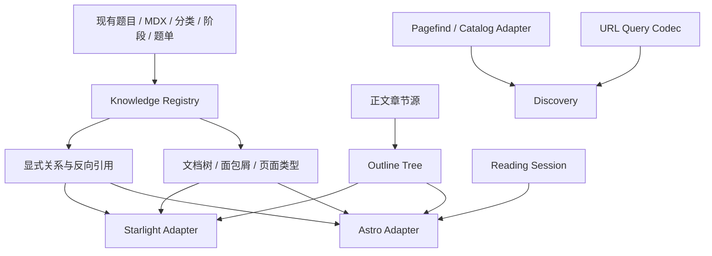

# 文档型 Wiki 重构技术方案与测试契约

日期：2026-10-18。状态：用户已确认技术方案及S1–S7测试边界；实施计划待审阅。

依据：`2026-10-18-docs-wiki-information-architecture-design.md`、`2026-10-18-site-resource-and-experience-v2-design.md` 和资源盘点JSON。代码基线为 `2da4d16`。执行方式沿用用户已选择的 Native；最后使用 review-agent 做只读缺陷审查。

## 1. 目标、范围和不变量

交付一个可实际使用的文档型知识库：左侧文档树、右侧H2/H3章节目录、Wiki显式关系与反向引用、集合内前后阅读、跨类型搜索，以及完整的失败恢复。保持首页、题库、分类、题单、路径、阶段、方法、手册和英文对应页面均可用。

内容盘点中的1,334题、12题专属分析、36个公开岗位阶段组合是现有事实，不随界面重构重新定义。适用性复核和逐题分析复核分别展示；不新增标准答案、候选人总分或“已掌握”推断。

保留Astro 7.4.0、Starlight 0.42.6、Pagefind 1.5.2、Node 24、静态GitHub Pages部署和现有URL。题目JSON端点继续可用；不要求消费者同时迁移。主工作区未提交内容不覆盖。

保留六入口顶栏和右上角准备状态；首屏不自动弹目标框、不隐藏整篇正文等待数据，也不靠固定高度补偿手册。

## 2. 架构选择

| 选项 | 收益 | 成本与结论 |
| --- | --- | --- |
| 全站迁入Starlight | 文档渲染一致 | 结构化题目、筛选与生成路由需要大迁移；不采用 |
| 继续给每个View加导航与脚本 | 局部修改快 | 状态、锚点和样式继续分散；不采用 |
| **共享知识模块＋两个渲染Adapter** | 内容和规则统一，复用现有结构 | 需要明确Interface和迁移桥接；推荐 |

Module按可复用行为拆分，Interface同时约定输入、错误、顺序和资源成本。真实Seam有两个主要Adapter：普通Astro页和Starlight文档页。浏览器存储与Pagefind/静态JSON是另外两个真实变化点；不为每个小函数制造抽象层。

## 3. Module、Interface与测试Seam

下列七个Seam是本轮建议测试的公开界面。按TDD技能要求，写测试前由用户确认；不测试私有DOM辅助函数或内部调用次数。

### S1 Knowledge Registry：内容身份与导航模型

拟放置：`src/lib/knowledge/registry.ts`、`types.ts`、`definitions.ts`。

Interface：`createKnowledgeRegistry(input): RegistryResult`；成功值提供 `page(contentId, locale)`、`navigation(contentId, locale)`、`relations(contentId, locale)`。构建输入通过Adapter从现有题目、taxonomy、模型、题单和文档读取。

- `contentId`与语言分离；题目使用 `question:<questionId>`，能力使用 `capability:<domain>.<leaf>`，文档使用显式稳定ID。
- 每种语言的发布页面有唯一URL；分页是结果视图，不创建新的知识条目身份。
- 每个知识条目只有一个主要父节点；可以被多个题单/主题引用。文档树不全量展开1,334题。
- 导航返回当前祖先、同组项、所属板块、面包屑和页面类型。页面不得自行再推导另一套归属。
- 文档树无环；关系图可以有环；没有实际内容的分组节点不伪装成文章。
- 重复ID/URL、缺失父节点、父子环、缺失显式引用目标为构建错误，返回带节点ID的诊断。翻译缺失可声明；未声明的缺失为错误。
- Registry构建期一次生成并缓存；浏览器不下载完整题目或关系图来生成侧栏。

### S2 Article Outline：文章正文与多级目录

拟放置：`src/lib/knowledge/outline.ts`、`src/components/docs/ArticleOutline.astro`。

Interface：`createOutline(headings, options): OutlineResult`，返回嵌套节点、稳定锚点与旧锚点别名。节点为 `{id, label, level: 2|3|4, children}`。

- H1只作为文章标题，默认目录只含H2/H3；有H4时默认不显示，配置显式允许才加入。
- 结构化Astro文章以章节描述生成正文标题与目录。MDX Adapter使用Astro/Starlight渲染元数据中的headings；不再维护第二份手写目录标题数组。
- 交互控件标题、卡片内标题、重复标签不进入目录；可选内容不存在时章节和目录同时省略。
- 只对声明属于正文目录的章节校验缺少ID、重复ID和H2跳H4。卡片/工具/表格标题不在此校验范围，避免把现有辅助标题误判成正文缺陷。相同正文标题文本可以重复，但必须有独立稳定ID。
- 已有 `objective-h` 等ID保持；标题改名后保留旧ID或别名。中英章节通过稳定sectionKey对应，不能机械拼接另一语言hash。
- 目录项定位使用原生锚点；当前章节高亮属于渐进增强，不滚动劫持，不在滚动时不断pushState。
- 普通页和Starlight只渲染一个目录。移动初始折叠在首次绘制前确定；内联脚本有独立作用域。

### S3 Relation Index：Wiki关系

与Registry共用类型，Implementation单独放 `src/lib/knowledge/relations.ts`。

Interface：`buildRelations(nodes, edges): RelationResult`，Registry只暴露对当前条目的查询结果。

- 关系类型：explains、prerequisite、applies、contrasts、uses-method、included-in。
- 现有relatedQuestions的relation/contrast作为编辑关联，不丢失解释。题单收录可从真实entries反推。
- 反向引用只从明确引用/收录生成；同topic或同capability推荐单独返回，不标“引用本文”。
- 去重按源、目标、类型处理；保留有意义的双向对比。自引用须显式允许，否则诊断；缺失目标阻断构建。
- 不自动为所有标签创建百科文章。概念入口先复用已有能力叶子，真实长文再使用MDX。

### S4 Browse Query：URL与状态契约

拟放置：`src/lib/discovery/query.ts`。

Interface：`parseBrowseQuery(url, context): QueryResult`、`serializeBrowseQuery(query, destination): string`；context包含base、locale、已发布分类和已解析本地目标。

`BrowseQuery`包括locale、scope（all/docs/questions）、q、target、facets、sort、page。首版沿用单值筛选，不顺手引入多选语义。目标覆盖顺序保持：合法显式链接 > 本地偏好 > 全部。

- 兼容已有q/role/scope/track/scenario/topic/format/capability/page/profile/profileRole/profileStage参数。
- 现有scope表示责任范围，新搜索范围用 `searchScope` 参数，禁止复用同名造成语义冲突。
- 单题阶段比较的targetRole/targetStage仍独立，不能写入全局准备目标。
- 关键词/目标/筛选变化重置page；前后浏览历史不重置。页码非法或越界统一归一。
- `profile=all`仍是显式选择，不与“没有参数”混淆。
- 未知筛选值提供诊断并移除该条件，不能静默制造0结果；未知与本功能无关参数按既有兼容策略保留，不能作为跳转目标解释。
- 分享URL包含当前有效目标；普通导航只传播链接明确携带的目标，本地默认不外泄到所有链接。
- 语言切换使用内容/章节对应表，保留可迁移条件；没有章节对应就回对应文章顶部。

### S5 Discovery：搜索、筛选与结果

拟放置：`src/lib/discovery/search.ts`、`pagefind-adapter.ts`、`catalog-adapter.ts`；两个旧结果页消费同一Module。

Interface：`createDiscovery(adapters).search(query): Promise<ResultPage>`。ResultPage包括按内容类型分组的结果、各组total/page、排序解释、已应用条件与失败/降级信息。

- 无关键词的题目浏览使用Catalog；有关键词使用Pagefind。Catalog保留静态JSON Adapter，Pagefind使用现有浏览器索引，均实现按条件返回完整候选顺序的Interface。
- Pagefind为内容标注kind、locale及题目适用profile和全部现有facet。所有条件在slice分页前应用；绝不先取20条再筛选。
- all范围分为“文档与方法”和“题目”两组，分别计数与显示；不把两个没有共同标尺的分数强行混排。切入一组后显示完整分页。
- 准备目标只限制question组。手册、方法、概念和阶段参考不附加题目profile过滤；题单标识适用性，不因单题目标过滤直接从知识搜索消失。
- 无q的题目列表保持稳定ID顺序；题单保持编辑顺序；有q显示相关性。界面明确排序依据。
- 联合选项计数依据当前q、目标和其他筛选，计算某一维度时排除该维度自身。初版只计算用户展开的筛选组，结果内缓存，避免每次输入触发所有组合查询。
- 仅加载当前结果窗口的Pagefind data；用sub_results提供章节直达。元数据作为文本渲染，所有URL经站内安全检查。
- 控制器使用递增请求版本丢弃过期搜索及结果data响应。Pagefind Adapter不假装支持物理取消；取消展示与中止真实网络要区分。
- `/search/`和`/questions/`旧路径都保留，以Adapter选择默认范围；共同实现搜索＋筛选，而不是互相跳转丢状态。

Pagefind支持返回匹配结果句柄后按页加载data，以及过滤和章节子结果；本设计依据官方API，具体Adapter在真实生产索引上做集成验证：[搜索API](https://pagefind.app/docs/api/)、[过滤配置](https://pagefind.app/docs/filtering/)。

### S6 Reading Session：有序集合与阅读来源

拟放置：`src/lib/reading/session.ts`、`storage.ts`、`src/components/docs/ReadingNavigation.astro`。

Interface：`createReadingSession(storage, registry)`返回 `open(context)`、`current()`、`move(direction)`、`updateCollection(action)`。存储Adapter是浏览器session/localStorage与内存fallback。

- ReadingContext有版本、locale、source URL、collection ID或有序questionIds、当前ID和阅读位置。
- 精选题单按编辑顺序；查询结果按该次已解析候选顺序。重查后内容变动不悄悄变成另一集合。
- 本次题单支持加入、去重、移除、排序、清空；只存ID和顺序，最多200题。超限拒绝新增并解释，不能静默丢题。
- 来源URL只接受同站、当前base和支持的内容路径；协议相对URL、反斜杠、控制字符、越界路径拒绝。
- 单题永久面包屑与临时来源并存。当前题被移除/失效时提供集合摘要和重新选择，不自动跳到无关题。
- 存储失败用内存并说明仅本页/当前标签页；损坏和旧版本数据不导致白屏。跨标签修改通知刷新集合信息，不能强制跳转当前阅读位置。
- 普通上一篇/下一篇来自编辑目录；上一题/下一题来自当前集合；到端点禁用并保持“回目录/回集合”。

### S7 Rendered Site：渲染、异步恢复和交互

公开Seam是构建后的HTML与用户可操作控件，使用Playwright检查真实浏览器。

- DocsShell由普通SiteLayout和Starlight PageFrame两个Adapter接入，消费同一navigation/outline/relations。两者共享tokens和导航行为，不复制业务逻辑。
- 左树的分组展开与文章跳转分开；当前页祖先自动展开，用户自己的展开状态可选保存。全站树、文章目录、阅读集合名称明确。
- 桌面三栏；平板先收右目录；手机文档树抽屉＋本页目录。导航切换、状态浮层不移动正文；刻意展开本页目录允许自然推开正文。
- 右上角状态与语言始终可达；恢复长标签完整名称。首访直接可读。
- 题目正文次序：问题/意图/信号/已有追问 → 专属分析或短共用提示 → 可选阶段/证据/AI工具 → 关系/来源/继续阅读。
- 手册和方法先整理现有章节；只为有真实内容的章节建新页。已有文章不因重构丢失正文。
- 四类请求（搜索、题库索引、目标菜单、阶段模型）统一idle/loading/ready/empty/error/degraded契约；错误后清除拒绝缓存，重试不会永久复用失败Promise。
- 数据结构与版本不兼容显示更新/重试提示；错误消息不暴露堆栈。纯文本与受校验URL进入DOM。
- JS不可用：文章、原生链接和静态分类可读；筛选/比较/本次题单控件隐藏或明确禁用，给静态入口。不能留看似可操作的死按钮。

## 4. 具体代码迁移

| 现有代码 | 处理方式 |
| --- | --- |
| routes/site-navigation/wiki-navigation/page-presentation | 保留外部导出作兼容Adapter，逐步委托Registry；全部调用者切换后删除重复映射 |
| WikiSidebar/WikiNavList | 接NavigationTree，支持分组折叠、明确当前节点与祖先 |
| WikiOutline＋手写outline数组 | 接OutlineTree；正文标题与目录共享章节源 |
| SiteMasthead中的搜索脚本 | 提取Search UI控制器，消费Discovery；页头只负责组合控件 |
| QuestionsView/SearchResultsView及对应客户端 | 共用DiscoverView和ResultPage渲染，保留旧route入口 |
| QuestionView/QuestionStageGuidance | 内容前置、工具按需显示，阶段比较不改全局目标 |
| ReadingJourney与return URL正则 | 委托Reading Session与Query Codec，保留旧session数据迁移/兜底 |
| stage-model-client/target-roles-client | 在已存在真实请求Seam收敛重试、响应校验和失败缓存处理 |
| global.css与Starlight补偿规则 | 先tokens/shell/reading/discovery/reference拆职责；逐条迁移后删除旧覆盖，不同时维护两套最终断点 |
| check-site-shell | 扩展到目录、锚点与关系校验，接入本地ci及GitHub build |

先迁移类型和行为，再搬目录。保留当前工作分支与main工作区隔离，不触碰未提交手册修改。

## 5. 构建与兼容

1. 读取schema校验后的题目和模型，构建Registry与RelationIndex。
2. 从编辑目录和真实内容生成每语言导航、文章序列与简短manifest；禁止发布研究快照、内部复核草稿或编辑工具产物。
3. Astro/Starlight Adapter渲染HTML与现有JSON；新数据另用版本化manifest，不改变旧端点返回形状。
4. Pagefind索引明确的正文、kind/locale/profile/facet元数据；工具、导航、重复框架和隐藏JSON不进入正文检索。
5. 构建后检查所有发布HTML、内部路径、资源、锚点、翻译对应与文档树，再执行大小和浏览器检查。

旧URL与锚点基线已保存到 `docs/reviews/2026-10-18-docs-wiki-compatibility-baseline.json`，按相同锚点集合去重存储；这是后续迁移的比较输入，不是已通过新实现的测试结果。旧URL清单以当前3,464个HTML为输入；题目ID和中文404.html特例保留。分页归一和内容拆页均记录旧URL→目标及锚点对应。没有对应内容的旧位置给可理解的说明和新入口，不能全部跳首页。

资源预算沿用现有检查，不以提升阈值掩盖体积增长。记录HTML、JS、CSS、题库索引、导航manifest与实际网络传输；不把完整dist大小当成单次下载。浏览器只接收当前导航分支、文章关系与结果窗口。

## 6. 测试矩阵：独立输入与预期

测试数据使用少量人工fixture明确关系和顺序，不从生产结果反推期望。正文与元数据全量校验再覆盖实际内容规模。

| Seam | 具体用例 | 预期 |
| --- | --- | --- |
| S1 | A为根、B为子、C为孙，访问C | 面包屑A/B/C，当前项C，祖先A/B展开 |
| S1 | A父B、B父A；重复URL；不存在父节点 | 构建失败并指出相关ID |
| S1 | 一题被两题单收录、只有一个主要能力 | 永久父节点不变，两条收录关系可查 |
| S1 | 声明英文缺失/未声明缺失 | 前者有回退提示；后者构建失败 |
| S2 | H2 A、H3 A1/A2、H2 B | 两个顶级目录节点，A包含两子项，顺序不变 |
| S2 | 两个同名H3但不同ID | 都能定位，不按标题文本去掉其中一个 |
| S2 | 缺失/重复ID、H2跳H4 | 明确诊断；不悄悄生成错误目录 |
| S2 | 可选背景无数据、工具内h3 | 均不产生虚假目录入口 |
| S2 | 旧anchor与中文sectionKey切英文 | 旧地址仍可定位；有对应则定位，无对应回对应文章顶部 |
| S3 | Q引用M；Q与R同topic | M反向引用有Q；R不被标成引用者 |
| S3 | 两次相同关系；缺失目标 | 去重；缺失目标构建失败 |
| S4 | 本地后端、链接前端；显式profile=all | 链接前端生效但不改本地；all确实解除目标 |
| S4 | scope=team与searchScope=docs并存 | 责任范围与搜索类型各自正确 |
| S4 | q/目标变化，原page=3；浏览器后退 | 新查询page1，后退恢复原查询page3 |
| S4 | 无效角色阶段、page=-2/NaN/极大、未知分类 | 显示诊断并归一，不白屏或伪造匹配 |
| S5 | 60候选，只有排名21–40匹配目标 | total20并返回这些题，不出现“无结果” |
| S5 | 已选前端高级，搜“使用说明” | docs组仍可找到手册；question组按目标筛选 |
| S5 | q＋主题＋题型；清掉某个条件 | 结果和计数按同一契约变化；分享/返回保留条件 |
| S5 | 旧慢查询先发后到、新查询先返回 | 最终界面保持新查询，data延迟也不能覆盖 |
| S5 | 空查询、零结果、恶意元数据/外链 | 可浏览入口/清除条件；文本转义，站外跳转拒绝 |
| S6 | 题单顺序q3/q1/q2，读q1 | 上一题q3、下一题q2，永久父节点不变 |
| S6 | 重复加入、移除当前、超200、失效ID | 去重、明确恢复入口、明确拒绝、说明被移除项 |
| S6 | 存储抛异常/损坏JSON/旧version | 内存降级，正文可读，用户知道保存范围 |
| S6 | 来源为//evil、其他base、控制字符 | 拒绝来源并使用题库/目录安全兜底 |
| S7 | 手机首次进入手册/方法/题目且JS延迟 | 最终折叠状态在首次绘制前确定，无目录脚本冲突 |
| S7 | 320/390/768/1024/1440px及长英文 | 无页面横向溢出；菜单/状态/语言可达；题库无空侧栏 |
| S7 | 文档树、文章目录、状态浮层键盘操作 | 当前项、aria-expanded、Escape、焦点返回正确 |
| S7 | 四类请求分别503→恢复 | 显示失败和真实重试；拒绝缓存不阻断恢复 |
| S7 | 题库失败且保留50静态题 | 明示未应用动态条件的降级，不误称当前目标结果 |
| S7 | 无JS直接打开内容/分类 | 正文与静态链接可用，依赖JS工具不伪装可用 |
| S7 | 新会话首次进入 | 不自动弹目标框，不先显示完整目录再收缩 |
| S7 | 从搜索第2页进入题目、语言切换和返回 | 条件、页码、来源集合与语言策略一致 |
| S7 | 12题专属分析/其余共用框架 | 标签与实际数据一致，无空知识章节 |

不测试私有函数调用、CSS类名的存在或“调用了几次内部方法”。浏览器断言可使用稳定data挂载点，但成功标准是可见内容、URL、可操作性和位置。

## 7. TDD实施切片与提交边界

按纵向切片执行，每次一个行为的红→绿，再接下一个；不得先批量写几十个想象中的测试。

1. 一篇手册和一篇方法的Registry查询→文档树/面包屑→非法树诊断。
2. 方法页H2/H3目录→正文共享章节→旧锚点→移动折叠；再接题目和Starlight Adapter。
3. 一条题目→方法引用→反向索引→真实题单收录；再扩全部内容。
4. q＋一个主题筛选→目标与docs分组→分页/计数→旧路径/分享/语言兼容。
5. 精选题单前后题→结果来源→本次题单与存储降级。
6. 数据失败重试→首屏层级/移动菜单→全站迁移→删除旧控制器和重复样式。
7. 全量构建、现有ci＋新增检查；review-agent只读审查完整diff，浏览器走查交互，修复确认缺陷并回归。

每片完成可运行页面，记录失败原因、实现提交与验证结果。若需要调整Interface，更新技术方案与测试契约，避免每个调用点自行兜底。

## 8. 交互审核与完成条件

review-agent审查目标固定为本轮开始提交到最终HEAD的完整diff，检查实际新引入缺陷，不以已有问题或风格偏好充数；它不修改或再委托代码。报告给出优先级、具体行与可复现场景。

浏览器走查单独覆盖：文档树进入文章、多级目录定位、Wiki引用与反向阅读、跨类型搜索、题单连续阅读、数据失败恢复，以及手机/英文/键盘。源码审查不能替代运行中的交互核对。

完成须同时满足：

- 前述七个Seam和用户动线均有实际通过证据；全站及中英文真实页面覆盖。
- `npm run ci`通过，站点壳/目录/关系检查已纳入GitHub工作流；不能只手工运行一次。
- 现有路径、公开数据形状、许可证和复核语义保持兼容。
- 代表页面320–1440px、长英文、200%缩放、无JS及存储失败行为明确。
- 冷加载布局偏移检查沿用<0.05回归阈值，区分用户主动展开；不靠隐藏正文满足指标。
- P0/P1/P2确定缺陷修复或有用户明确接受的处理决定；记录实际残余限制。
- 技术方案、实施记录、最终审查报告和PR描述与实际HEAD一致。

本文件的下一步是技术规范与测试Seam审阅；通过后按已选Native方式生成实施计划并开始TDD，不再重选执行方式。
