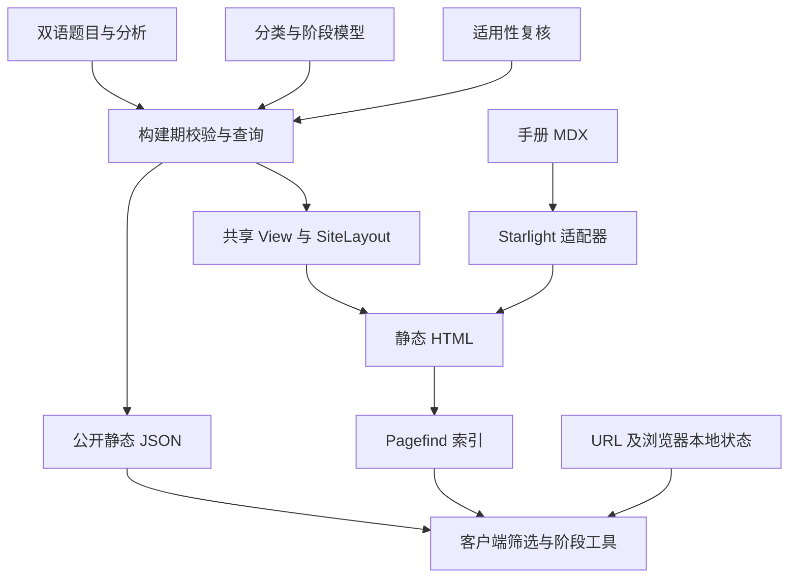

# Interview Compass：资源、功能覆盖与 V2 重构设计

日期：2026-10-18。状态：完整设计提案，尚未实施。

## 1. 依据、范围与结论

本报告以独立工作区 `codex/wiki-knowledge-experience` 的 `0fc7b9b` 为代码快照，结合本地生产预览检查首页、题库、搜索、题目、目标路径、阶段总览、分类与手册。PR #12 当前未合并；GitHub check/unit/build 已通过，部署步骤按 PR 条件跳过。主工作区仍在另一分支且有未提交手册编辑，不将它与预览版本混为一谈。

盘点覆盖源文件、全部题目记录、生成的 HTML 和数据产物，以及用户界面中的主要交互。内容统计是全量机器统计；交互判断来自源码及代表页面，未逐题人工评审 1,334 道题。资源明细和原始计数见 `docs/reviews/2026-10-18-site-resource-inventory.json`。

**判断：站点已经具备完整题库、分类与阶段参考的基础，但缺少把这些能力串成准备任务的统一入口。** 上一轮解决了导航丢失、布局抖动和阅读返回。本轮需要继续解决搜索与筛选割裂、阅读主次倒置、内容复核等级不易辨认、异常恢复不一致，以及状态和导航规则分散的问题。

V2 目标是让用户用一小组相关问题完成一次准备、访谈或复盘。保留静态发布和既有内容，形成「发现题目 → 选择集合 → 阅读与比较 → 返回并继续」的稳定动线。

## 2. 全站资源账本

### 2.1 内容对象

| 对象 | 当前规模 | 来源与作用 |
| --- | ---: | --- |
| 稳定题目 ID | 1,334 | 每题一个主要能力，跨分类复用 |
| 中英文题目记录 | 2,668，全部 published | `src/content/questions/{zh-CN,en}/*.md`，主要数据在 frontmatter |
| 专属逐题分析 | 12题、24条双语记录 | `src/data/question-specific-analyses.json`；约占题目0.9% |
| 岗位阶段适用复核 | 1,334条，全部 reviewed | `src/content/question-applicability.json`；说明哪些岗位阶段适用，不等于专属分析已复核 |
| 能力分类 | A–H八个域，47个实际使用的叶子 | `taxonomy.ts`，三组上位组织视角 |
| 主题 | 51个实际使用值 | 技术、业务和方法的交叉索引 |
| 岗位 | 原始题目使用12种；公开目标6种 | 通用工程、前端、后端、客户端、AI、数据；其他职能保留研究/来源语境 |
| 其他分类 | 责任范围4、职业轨道4、使用场景6、题型8 | 相互独立的筛选维度 |
| 公开岗位阶段 | 6岗位，各6阶段，共36个选择组合 | `role-stages/registry.ts`、catalog、expectations |
| 共用阶段模型 | 6阶段、4评价维度、112条阶段标准 | 双语 capability-model JSON；与A–H知识分类用途不同 |
| 精选集合 | 5个：通用面试、技术精选、面试官取证、晋升对话、岗位尽调 | 前4个题单；岗位尽调是结构化候选人反问指南，不全是题库记录 |
| 跨能力主题路径 | 5条 | 产品全链路、提问探询、业务规划、技术规划、团队规划 |
| 使用情境路线 | 6条 | 求职、面试官、晋升候选人/评审、自我练习、项目复盘 |
| 方法与说明 | 双语提问方法页面和双语 Starlight 手册 | 方法提供判断框架，手册解释使用方式 |
| 来源账本 | 42个文件 | `docs/planning/source-ledger/`，与公开题目 source 署名关联 |
| 站外使用能力 | 1套 coach skill及取题脚本、证据参考 | `skills/interview-compass-coach/`；可读取公开JSON，不是站内托管AI服务 |

题目可选字段覆盖：836题带 followUps；16题有显式 relatedQuestions，共18条关系；background 字段当前为0题。其余页面中的共用背景提示和推荐不能被描述成已编辑的专属知识讲解。

source 类型统计：original 1197、inspired 253、derived 206、adapted 10。它们是来源声明条数，一题可以多来源，不能相加当作题目总量。

### 2.2 页面与路由

源端有58个页面/端点文件，通过21个共享 View 生成3,464个 HTML。下表为中英文合计，包含索引、详情和该类分页。

| 页面族 | HTML数 | 用户用途 |
| --- | ---: | --- |
| 首页 | 2 | 选择入口 |
| questions | 2670 | 2668题目详情＋双语题库 |
| search | 2 | Pagefind关键词结果 |
| collections | 12 | 题单索引、4题单与1反问指南 |
| paths | 10 | 5条跨能力主题路径 |
| roles | 266 | 6公开岗位索引/详情/分页 |
| scenarios | 162 | 使用情境总览、场景分类详情/分页 |
| topics | 184 | 主题索引/详情/分页 |
| capabilities | 112 | 能力地图、域、叶子 |
| capability-model | 36 | 总览、阶段、维度、岗位模型、职级映射 |
| browse | 2 | 分类入口聚合 |
| framework | 2 | 提问方法 |
| handbook | 2 | Starlight使用说明 |
| 404 | 2 | 中文404.html、英文404/index.html |

四类静态JSON端点：`data/questions/{locale}.json`（轻量题库索引）、`data/question/{locale}/{id}.json`（单题及评估参考）、`data/target-roles/{locale}.json`（目标选择）、`data/stage-model/{locale}.json`（岗位阶段阅读参照）。它们是构建产物，不能按动态服务的可用性和更新机制理解。

### 2.3 实现、素材和交付

- 框架：Astro 7.4.0、Starlight 0.42.6、Pagefind 1.5.2、Node 24；内容以静态构建发布到 GitHub Pages 子路径。
- 结构：21个组件文件、21个View、40个lib模块；页面文件主要负责参数与双语入口，View承载主要内容。
- 素材：logo.svg、favicon.svg、icons.svg；图标是共享SVG sprite，当前实际运行依赖没有 `@lucide/astro` 或 Radix 包。字体使用系统栈，未看到自托管字体文件。
- 样式：global.css 约861行、74.6KB源码，加Starlight适配和组件局部CSS；存在多轮追加的页头、状态、网格和断点覆盖。
- 数据成本：当前 dist 约198MB（十进制），其中data约24MiB、Pagefind约14MiB；这些是完整产物大小，不是用户一次访问的下载量。中文题库索引原始JSON约1.67MB；阶段模型约99.8KB；目标菜单约8.2KB；示例题HTML约44.9KB。应测实际传输与解析，不据总目录大小断言页面慢。
- 工具与质量：9个scripts、35个单元/浏览器测试文件；内容schema、双语配对、相似性、来源、阶段覆盖、构建大小、浏览器动线均有既有工具。
- CI：check、unit、build；主分支才deploy。新增加的 `check-site-shell.mjs` 尚未接入package.json的ci链和GitHub工作流，这是自动化覆盖缺口。
- 文档：45份Markdown研究/设计/计划/复核文档，另有设计工具快照。PRODUCT、DESIGN、CONTEXT与实际实现存在部分用词漂移，需要明确哪些规范仍有效。

## 3. 现有实现如何运转



四组规则共同决定页面：routes.ts负责URL/标题/面包屑/旧导航归属；site-navigation.ts负责顶栏；page-presentation.ts负责页面族；wiki-navigation.ts负责局部导航。它们当前能工作，但归属规则分散，后续新增页面可能只更新其中一处。

运行时存在三类状态：

1. 浏览目标：`profile/profileRole/profileStage` URL覆盖localStorage偏好；选择全部保留上次目标；存储失败时退回当前页。
2. 结果状态：q、分类筛选、page在URL；题库本地筛选和Pagefind关键词搜索分别实现。
3. 阅读状态：sessionStorage存一条来源、目标题、滚动位置与展开区；单题阶段比较另外使用 `targetRole/targetStage`。

这解释了为什么“修改准备目标”和“比较题目阶段”容易被混淆，也解释了复杂返回、多标签与切换语言需要单独处理。

## 4. 交互与功能覆盖矩阵

标记：有=已实现；部分=能力存在但流程或恢复不完整；无=尚未提供。无不等于必须新增，优先级取决于准备任务。

| 功能/场景 | 当前覆盖 | 问题或边界 | V2决定 |
| --- | --- | --- | --- |
| 全站顶栏、所属板块 | 有 | 普通布局与手册已共享 | 保留六入口和现有路径 |
| 小屏菜单/键盘/Escape | 有 | 双目录与菜单仍需统一命名 | 统一控件语义和断点来源 |
| 右上角准备目标 | 有 | 长名称省略；状态与动作混在同一入口 | 双行/完整可访问名称，浮层展示完整状态 |
| 主动选择、清除、修改目标 | 有 | 与页面岗位筛选可能重复 | 明示全局目标与额外条件的交集 |
| 链接目标覆盖、本地目标不被写入 | 有 | 分享语义复杂 | 共用状态摘要，保留明确采纳动作 |
| 目标菜单加载失败/重试 | 有 | 上轮已补 | 纳入统一异步状态组件 |
| 关键词搜索与即时建议 | 有 | 结果独立于筛选题库 | 合并为同一发现流程 |
| 搜索后叠加主题/题型/能力筛选 | 部分/断点 | search结果页没有这些控件；题库逻辑不以q匹配题目 | V2首要补齐 |
| 筛选后继续关键词检索 | 部分/断点 | 页头提交到另一结果页，不能假设全部页面条件被保持 | 统一BrowseQuery解析与URL写入 |
| 筛选计数 | 部分 | 选项计数考虑目标，但不同时考虑其他已选条件 | 提供去掉自身维度后的联合计数；明确0结果原因 |
| 结果排序 | 部分 | 题库按稳定ID排序，搜索有Pagefind排名；界面缺少排序说明 | 关键词时默认相关性；无关键词显示稳定浏览顺序；题单保留编辑顺序 |
| 筛选分页、历史与分享 | 有 | 题库50/页，搜索20/页；两套控制逻辑 | 统一结果窗口与分享规则，保持旧URL兼容 |
| 题库索引请求失败 | 部分 | 报错但无重试；保留前50静态题目，可能与目标不一致 | 明示降级状态、暂停无效筛选并可重试 |
| 题目直接访问 | 有 | 范围外仍可读，有提示 | 保留，不硬拦内容 |
| 题目主要内容 | 有但层级偏后 | 示例题客观问题在1440×1000视口约1167px处 | 问题→意图→信号/追问先呈现 |
| 专属分析与共用框架区分 | 有但不足 | 12题专属，其余大量相同框架段落 | 页面首屏标明内容类型；共用框架收敛为按需参照 |
| 背景知识 | 数据字段有，专属内容覆盖无 | background 0题 | 有内容才显示；不生成空“知识讲解”承诺 |
| 相近/对比题 | 部分 | 仅16题有显式关系；其他相关入口依据分类 | 区分编辑对比关系与同类题；优先建设题单内对比 |
| 阶段比较工具 | 有 | 位于题目正文前，和全局目标是不同状态 | 移到“按我的阶段理解”折叠工具，默认继承全局目标 |
| 阶段数据加载失败 | 部分/断点 | 客户端catch直接return，无明确错误与重试 | 保留正文可读，工具显示失败、重试与静态模型入口 |
| AI分析Prompt生成/复制 | 有 | 不是在线AI分析；工具抢占主要阅读顺序 | 放工具区，生成前可预览数据范围，复制失败可手工取用 |
| 题单顺序、适用理由 | 有 | 题单详情可读，但逐题前后移动能力有限 | 在题单上下文显示上一题/下一题与序号 |
| 当前结果/题单返回 | 有 | 只保存单个最近来源；没有稳定的整组阅读上下文 | 集合ID与位置分离，刷新和多标签行为有明确降级 |
| 最近阅读/收藏/临时题单 | 无 | 并非已有功能 | V2加入本地“本次题单”；收藏/历史作为可关闭的本地便利，不做完成率 |
| 笔记、作答、训练计时 | 无 | 当前是参考题库，不是练习工作台 | 暂不加入本轮，避免新增隐私/编辑/恢复子系统 |
| 目标路线到第一组题目 | 部分 | 有六种情境，但部分先导向宽泛岗位/大结果集合 | 每条路线给一组起始题、选择理由和替换条件 |
| 阶段总览 | 有但认知负担高 | 实际页面49个details，DOM文本约8420字符（含折叠内容）；多个模型并列 | 先岗位＋阶段摘要，再看4维度；完整矩阵作为参考页 |
| 双语对应与参数保留 | 有 | 多处手工列参数，新增状态容易漏传 | URL codec定义可迁移参数，锚点有对应表/兜底 |
| 无JavaScript | 部分 | 静态正文、导航和分类可读；题库只前50题；部分工具按钮没有可用动作 | 明确降级：隐藏/禁用依赖JS工具，提供静态浏览链接 |
| 搜索空/错误/慢请求竞争 | 有 | 已有状态与测试 | 在新发现页复用，不重写语义 |
| 404、资源子路径、许可 | 有 | 中英404物理路径不同；代码/内容许可分开 | 保留与自动检查 |
| 分享预览与搜索引擎元数据 | 部分 | 普通页面有title/description；未见常规canonical、hreflang、OG、sitemap链路 | 补齐稳定内容页面SEO，不索引任意筛选组合 |
| 用户任务效果观测 | 无 | 测试证明功能可用，不证明用户找到合适题目 | 先做5条任务走查/人工观察，不默认接入追踪服务 |

### 4.1 最容易遗漏的边角规则

- 目标、额外筛选、单题比较分别标注；页面不能把“对比一次管理阶段”变成用户全局目标。
- 加载失败时不能静默显示不符合当前筛选的默认题；可以显示，但必须明示“未应用筛选的静态列表”。
- 缺少专属分析、背景和显式关系时，显示真实可用内容，不用大段通用模板制造内容密度。
- 复制失败、存储受限、无脚本、慢请求、返回旧页码、非法参数、失效题目ID都有明确恢复路线。
- 题单里的“已加入/正在查看”是操作状态；不能当作掌握程度、学习完成率或候选人评分。
- 桌面侧栏、移动目录、文章目录、全站导航分别承担不同职责，名称和焦点不能混用。
- 来源可以多条，来源类型与分析复核状态分开；不能以来源可靠替代本题分析复核。

## 5. V2用户动线

### 5.1 第一次准备

首页说明用途 → 选择本次情境（求职/晋升/访谈/复盘）→ 可选岗位阶段 → 推荐一小组题目并说明理由 → 开始读第一题 → 下一题/回题单。用户随时跳过目标直接搜索，不强迫先理解A–H和阶段矩阵。

### 5.2 已经知道要找什么

任意页搜索 → 同一发现页保留q与准备目标 → 加主题/题型等条件 → 查看结果摘要与数量 → 打开题目 → 回到完全相同的结果位置。主题/能力/岗位入口全部落到同一发现模型，不产生互不相通的查找流程。

### 5.3 准备一次面试或评审

进入已有精选题单或路线 → 看适用对象和每题理由 → 加入本次题单（浏览器本地）→ 逐题看意图和追问 → 回到清单调整顺序/移除。岗位尽调保留“反问指南”类型，不强制伪装成可评分题目。

### 5.4 从单题链接进入

直接看到问题、考察意图、核心信号和追问 → 需要时展开岗位阶段参照/共用证据框架 → 对比有明确关系的题或同类题 → 加入本次题单/返回原结果。有来源则显示来源上下文，无来源则给发现页兜底。

### 5.5 想理解成长要求

阶段能力入口 → 选岗位和当前关注阶段 → 一页责任摘要、4维度证据、相关题单 → 进入题目。共用6阶段模型、岗位专属模型、A–H知识能力和外部职级映射在页面中明确标注用途，完整矩阵按需进入。

## 6. V2站点结构与页面设计

保留用户熟悉的六入口及稳定路由。调整每个入口内部组织，优先让现有页面形成一条任务链。

```text
首页：搜索、按本次任务开始、精选题单
├─ 目标路径：六种使用情境 → 起始题单 → 可选岗位阶段
├─ 面试题库：统一搜索与筛选 → 结果/题单切换 → 单题
│  ├─ 精选题单与反问指南
│  ├─ 本次题单（本地、可清空）
│  └─ 单题：核心阅读 → 可选工具 → 继续当前集合
├─ 分类索引：主题 / 岗位 / A–H能力 → 同一发现流程
├─ 阶段能力：岗位阶段摘要 → 维度详情 → 相关问题
│  └─ 参考：完整矩阵、共用阶段模型、外部映射
├─ 提问方法：提问和证据框架，关联题目示例
└─ 使用说明：怎样开始、状态含义、隐私/来源/许可
```

### 6.1 发现页

同一结果区域容纳关键词、当前目标、条件摘要与结果。关键词、主题、题型最容易发现；责任范围、轨道、能力细分放在更多条件。每个条件解释它会怎样改变结果。

结果行展示问题、主要能力，以及有事实支撑的专属分析标记；必要时显示“为何适合当前目标”。支持加入本次题单。不要把所有分类标签堆在每行。

q存在时Pagefind产生候选/排序，现有分类与目标规则在分页前应用；不能先取20条再过滤。无q时使用本地轻量索引并采用可说明的稳定顺序。两种引擎输出同一ResultPage类型和状态模型。

保留 `/search/` 与 `/questions/` 旧地址；初期两者共享发现页实现，URL规范化由codec处理，不立即删路径。后续是否用301/静态跳转必须单独评估托管能力和外链。

### 6.2 题目阅读页

从上到下：返回当前集合/序号 → 问题与短标签 → 考察意图 → 核心信号与已有追问 → 专属分析（有才显示）→ 可选工具 → 编辑关系/同类题与来源 → 上一题/下一题/回集合。

共用框架、阶段比较、AI Prompt放在“辅助理解”区。未复核题首先展示真实题目内容，再给简短状态说明和共用框架入口。宽屏右侧本页目录只列正文实质章节；移动端不让辅助选择器把正文推过多个屏幕。

设计验收：在1440×1000和390×844的默认访问中，应能无需打开工具就看到考察意图；更长题干允许自然占行，不能为固定高度而截断问题。

### 6.3 阶段页与参考页

默认只突出一个岗位阶段，提供责任摘要、四维度与代表题目入口。对比另一个阶段作为主动动作；完整A–H矩阵、专业/管理分支和职级映射分别放入参考区域。不是删除数据，而是给每种模型清楚的入口和使用时机。

### 6.4 本次题单

这是V2唯一建议新增的用户工作区能力：加入/移除/排序、当前题位置、清空；仅存questionId和顺序，不要求账号。手动加入叫“本次题单”，查看过叫“最近查看”，不显示“已掌握”。无存储时提示仅当前标签页可用；失效ID从集合排除并提示。

分享已有题单继续使用稳定URL。自建题单分享先评估编码长度和许可，不把任意长JSON放URL；V2可先导出ID清单，不承诺跨设备同步。

## 7. 实现结构重组

保留Astro和Starlight，不把全部结构化题目迁移成文档，也不为这次重构引入后台和账户。

| 模块 | 单一职责 | 现有代码调整 |
| --- | --- | --- |
| domain/questions | 题目、复核状态、来源、关系 | content-model、evaluation、applicability分清对象，UI不自己猜复核等级 |
| domain/taxonomy | 分类定义与边界 | taxonomy拆定义/校验/双语标签；保持ID |
| domain/stages | 责任模型和适用关系 | 共用模型、岗位模型、题目适用性分离 |
| application/discovery | 统一q、目标、分类、排序、分页 | 合并两个发现流程的状态与结果接口 |
| application/reading | 来源集合、位置、上一题/下一题 | 扩展单条reading-return，避免依赖散落DOM |
| application/target | 有效目标、本地偏好、链接覆盖 | 一个解析器和状态订阅入口；移除已停用自动弹窗的残余策略 |
| navigation/registry | 路由、所属板块、页面族、局部导航 | 合并4处映射为一个声明式注册表，再派生顶栏/侧栏/面包屑 |
| ui/shell | 页头、搜索框、状态、菜单、footer | SiteMasthead不再同时实现搜索引擎、状态编辑和链接迁移 |
| ui/discovery | 条件、结果、空态/失败/分页 | 共用客户端与服务器渲染的结果组件 |
| ui/reading | 核心题目、可选工具、关系和来源 | 工具按需挂载，不在正文前堆控件 |
| adapters/starlight | 只适配文档结构与主题 | 保留自然高度PageFrame，减少全局选择器依赖 |

代码目录按上述职责逐步迁移，先形成稳定接口，再移动文件。避免一次搬动40个lib导致只改路径、不改边界。

关键契约：

- `BrowseQuery`：locale、q、target、facets、sort、page；现有profile参数仍作为兼容输入。
- `ResultPage`：questionIds、total、page、pageSize、order、appliedConditions、loading/error/degraded状态。
- `ReadingContext`：来源类型与URL、集合ID/题目顺序、当前位置；sessionStorage与本地题单分别持久化。
- `ContentStatus`：published、适用性review、逐题analysis review各自独立。
- `RouteDefinition`：稳定path、section、presentation、breadcrumb与locale对应关系。

样式按tokens、shell、discovery、reading、reference和starlight-adapter组织，减少重复媒体查询。先定义字体、间距、行宽和断点，再迁移使用者；同步修正文档中Radix/Lucide与实际SVG实现的差异，不因文档写了某库就强行增加依赖。

构建时生成紧凑公开索引、关系和内容质量统计；客户端仅加载当前任务需要的数据。schemaVersion与部署版本可用于发现旧缓存。总产物和实际首屏传输分别设预算，Pagefind检索索引按它现有机制加载，不将完整14MiB当作首屏资源。

## 8. 优先级与交付切片

1. **V2.1 闭合找题流程**：统一关键词与筛选、分享/返回/语言参数；修复题库/阶段数据失败恢复；将站点壳检查接入CI。第一交付是一条可从搜索一直走到返回的流程。
2. **V2.2 阅读内容分层**：核心内容前置、工具后置；区别两种复核；题目关系与来源清楚；阶段总览精简到岗位阶段摘要。
3. **V2.3 本次题单**：选题、顺序、逐题前进后退、本地状态与失效ID处理；沿用现有精选题单与反问指南。
4. **V2.4 内部收敛与可发现性**：导航registry、query codec、共享异步状态、样式分层、元数据和规范文档同步。
5. **内容建设并行**：优先补起始题单的专属分析和编辑对比关系，按覆盖质量决定扩充；不把适用性reviewed改名为内容精审完成。

每个切片都应可单独审阅和上线；旧URL先保持有效。先共用新服务于旧页面，再切换页面内容，最后清理旧控制器和废弃策略。

## 9. V2验收场景

- 新用户：无需配置进入一个推荐题单，能解释为什么选这些题。
- 明确需求：输入关键词，再加主题/题型；结果计数、URL、分页一致，返回不会丢条件。
- 内容阅读：默认先看到意图和追问；仅12题的专属分析标记真实存在，其余明确使用共用框架。
- 准备任务：加入3题、改顺序、打开第2题、前后切换、刷新并恢复；不产生评分/掌握状态。
- 阶段：选择岗位阶段看代表问题；单题比较不改变全局目标；完整矩阵有入口。
- 恢复：题库索引/阶段模型/搜索/目标菜单各自503后都有真实可操作的重试或降级，不误称结果已应用筛选。
- 多标签与语言：来源集合、目标和界面语言分别正确；锚点无对应时回到可理解的位置。
- 可访问性：键盘、Escape、焦点、当前项、长英文、200%缩放、320–1440px及减少动效检查；无脚本控件不伪装可用。
- 发布：schema/双语/来源/阶段校验、全部HTML导航与内部链接、单元和浏览器任务测试、大小及首屏偏移均进入CI。

本轮代表页面浏览核对了控件、目录和主内容位置；另对题库索引与阶段模型注入503响应验证恢复行为：题库显示加载失败且仍有50条静态题，无重试；阶段工具未显示失败或重试，两个选择器仍启用。该观察支持矩阵中的两个异常恢复缺口。检查结束后已移除请求拦截；没有更改生产数据或页面代码。

本报告产出是可执行的重构设计；本轮没有改变页面功能。下一次实施以V2.1闭合找题流程为起点，保留已完成的导航与右上角状态修复。
